<p align="center">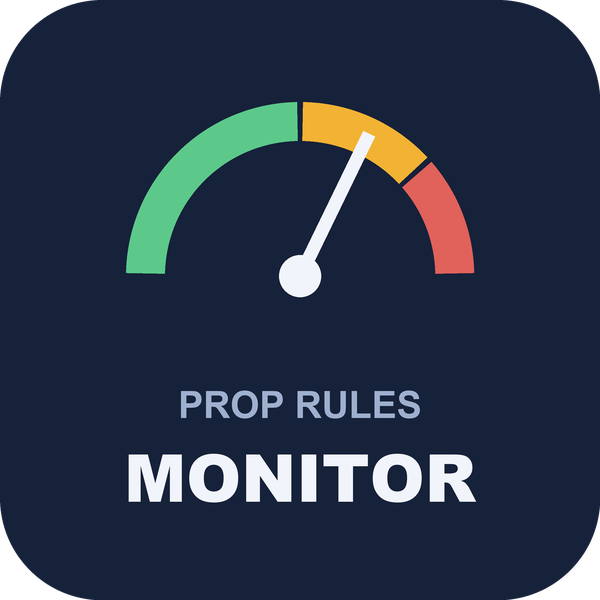</p>

# Prop Rules Monitor (MetaTrader 5 and MetaTrader 4)

A free indicator that shows, live, **how close the account is to a prop-firm style daily loss limit and max loss**, measured on
equity with the reset time and time zone you type in, and warns at a level you choose and at a breach. It only watches: it never
opens, closes or changes a trade, so it works without automated trading enabled. Source for both editions, the tests of its
rule engine, and the maths in plain words.

**Website:** [allanninal.dev/mql5 (utilities)](https://www.allanninal.dev/mql5/#utilities) · [MT4 editions](https://www.allanninal.dev/mql5/#mt4) · [allanninal.dev](https://www.allanninal.dev)
· **Contact:** message me on [LinkedIn](https://www.linkedin.com/in/allanninal/).

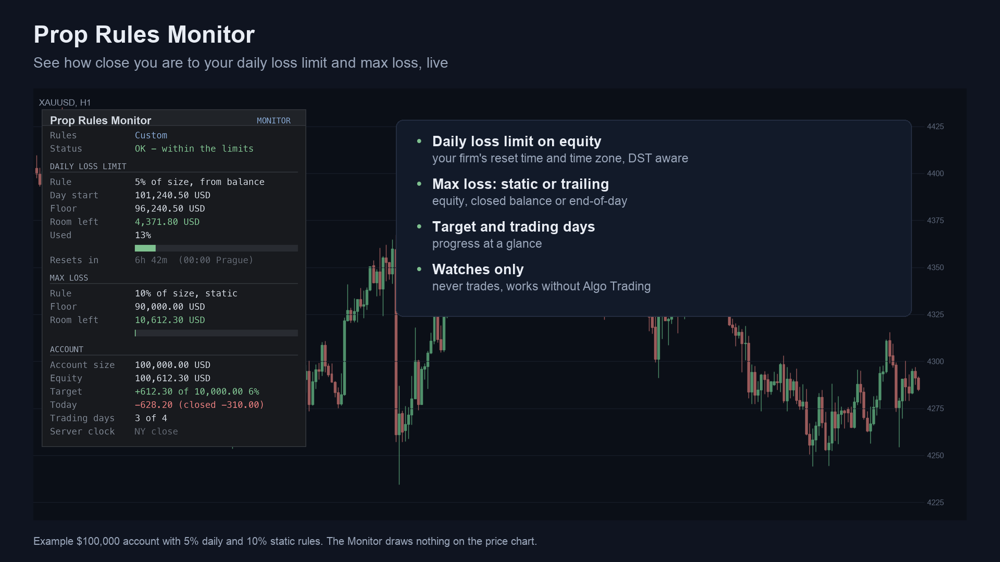

> It measures limits you type in; it does not know any firm's rules and does not enforce anything. Check your own firm's rule
> pages. Nothing here is a profit claim or a promise that an account passes (see [Honest limits](#honest-limits)).

## Get it on the MQL5 Market

| Edition | Platform | Price | Link |
|---|---|---|---|
| Prop Rules Monitor | MT5 | free | <https://www.mql5.com/en/market/product/201817> |
| Prop Rules Monitor MT4 | MT4 | free | <https://www.mql5.com/en/market/product/202433> |
| Prop Rules Guard MT5 | MT5 | paid | <https://www.mql5.com/en/market/product/201823> |
| Prop Rules Guard MT4 | MT4 | paid | <https://www.mql5.com/en/market/product/202436> |

The Market builds are the same calculation as the source in this repository. The Guard is a separate, paid product that is **not**
part of this repository (see [Free vs Pro](#free-vs-pro)).

## Contents

1. [What it is and who it is for](#what-it-is-and-who-it-is-for)
2. [Why it was built](#why-it-was-built)
3. [How it works](#how-it-works)
4. [How it was tested](#how-it-was-tested)
5. [Architecture](#architecture)
6. [Inputs, alerts, install and compile](#inputs-alerts-install-and-compile)
7. [Run the tests](#run-the-tests)
8. [Honest limits](#honest-limits)
9. [Free vs Pro](#free-vs-pro)
10. [Licence](#licence)

## What it is and who it is for

**What:** a panel on the chart with
- the **daily loss limit**: the day-start reference, the floor, the room left, the share used (with a bar) and the time to the reset;
- the **max loss** (static, trailing or two-stage): the floor, the room left and the share used;
- the **account**: size, equity, profit against the profit target, today's result, trading days against a minimum;
- a **status** line (OK, WARNING near a limit, a breach) and **alerts** by pop-up and push notification.

**For:** traders on prop-firm evaluations or funded accounts who want to see their distance to the limits at a glance. Also for
developers who want a tested rule engine for day-start, reset zones and floors.

**Not for:** anyone who wants it to protect the account. It warns; it does not act.

| | |
|---|---|
| 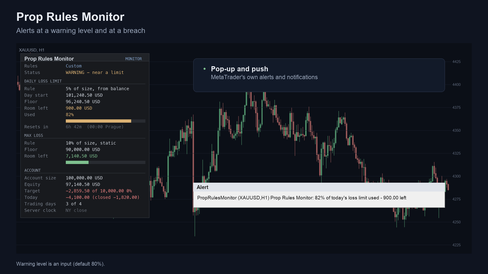 | 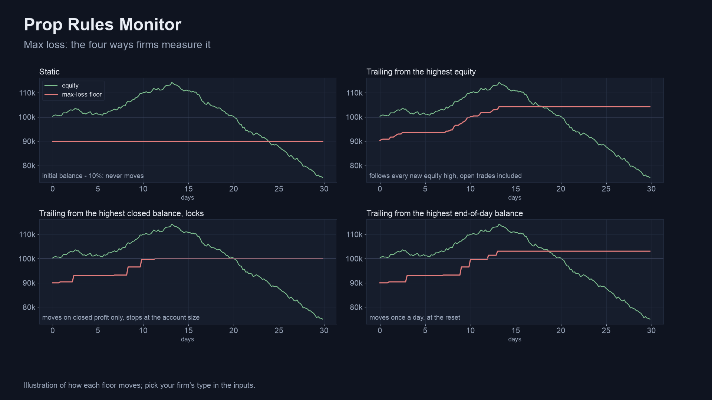 |
| 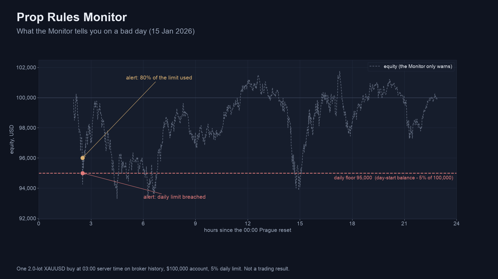 | 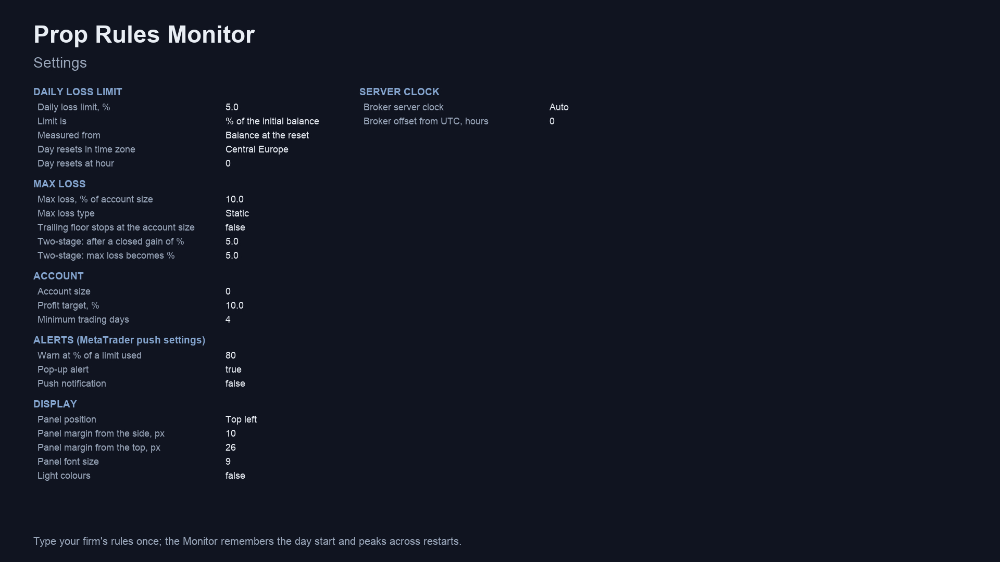 |

Image notes: panel values are an example $100,000 account; charts are drawn from broker history or illustrate how each floor moves;
they are illustrations, not terminal captures, and not trading results. MT4 versions are in [`docs/images/mt4/`](docs/images/mt4).

## Why it was built

- **The limits are easy to misread.** Firms measure the day from a reset in their own time zone and measure max loss in different
  ways (static, trailing from equity, balance or end-of-day balance, two-stage). A panel that does the arithmetic live removes a
  common source of mistakes.
- **Demand, from our October 2026 look at the MQL5 Freelance board:** 76 of 2,014 scraped jobs (Nov 2025 to Oct 2026) were in the
  prop-firm / guard group, and equity and daily-drawdown protection appeared in 93 jobs (medians roughly 75 to 115 USD). Those are
  bespoke jobs, not proven Market demand, and supply is crowded; so this is a free tool.
- **Provable maths.** The reset-time and daylight-saving logic is checked against the system time-zone database, and the history
  scan against an independent Python rebuild.

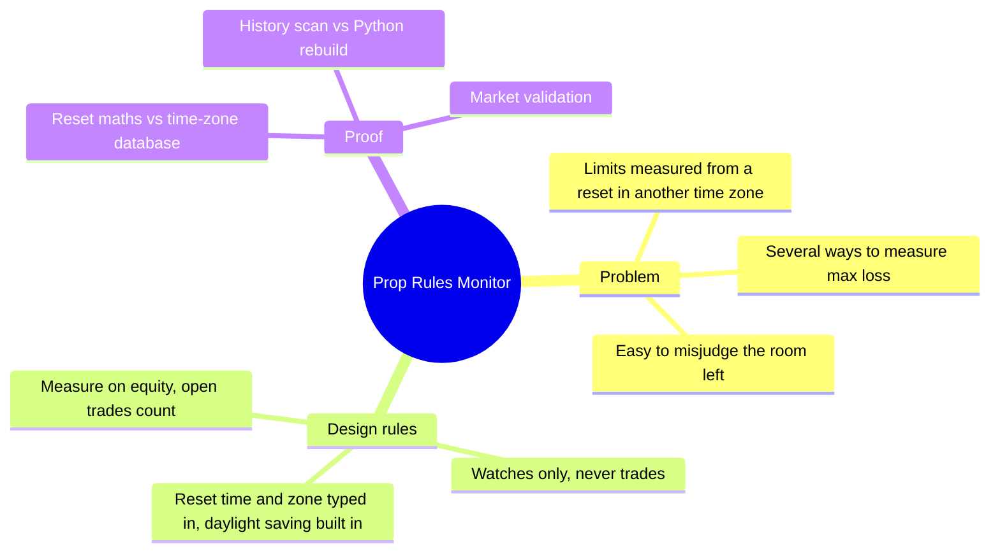

## How it works

### The maths, step by step

1. **Day start.** The reset is an hour (0-23) in a zone you pick: broker server time, Central Europe, UTC, New York, London or
   UTC+3. The broker's own clock is detected (or set: New York close, EET, fixed offset); daylight saving uses built-in rules (US:
   second Sunday of March to first Sunday of November; EU: last Sunday of March to last Sunday of October). The reference is the
   balance, the equity or the higher of the two at the reset instant. If the indicator was not running through the reset, the day
   start is rebuilt as `balance - (money moved since the reset)` and the panel says "rebuilt".
2. **Daily floor.** `limit = daily% x account size` (or `x day-start reference`), `floor = reference - limit`. Breach: `equity <= floor`.
   `used = (reference - equity) / limit`.
3. **Max-loss floor.** `amount = max% x account size`.
   - Static: `floor = account size - amount`.
   - Trailing: `floor = peak - amount`, with `peak` the highest equity, closed balance or end-of-day balance (optionally the floor
     stops rising at the account size).
   - Two-stage: `account size - max%` until the closed balance has gained a set %, then `account size - a smaller %`.
   - `used = (amount - (equity - floor)) / amount`.
4. **Account size** is the input, or the first deposit in the history.
5. **Alerts.** One warning when `used >= the warning level` (daily: once a day; max loss: once, re-armed after a clear recovery),
   and a breach alert when equity is at or below a floor. Nothing is sent in the Strategy Tester.
6. **Late first tick.** At the reset crossing, money already closed after the reset instant (a gap, the terminal off, stops filled) is
   taken out of the new day start and of yesterday's end-of-day balance.

### Per-update algorithm

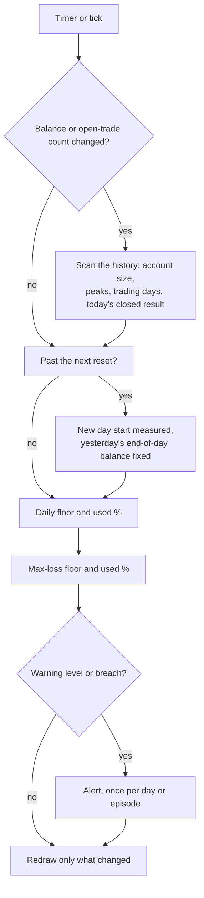

### Status states

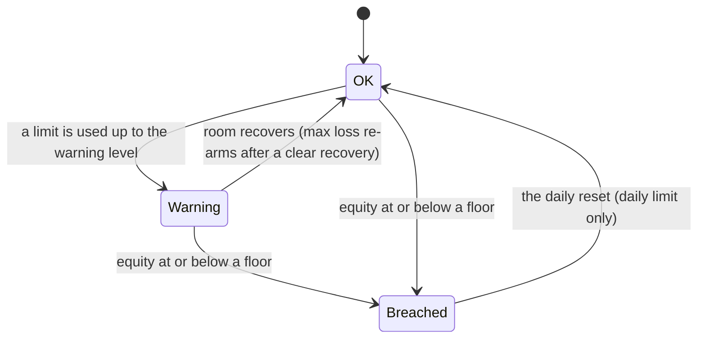

### Alert flow

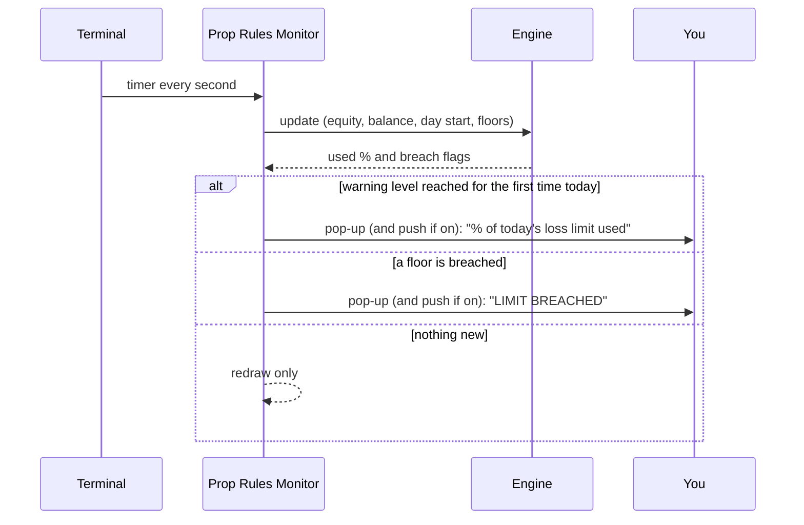

## How it was tested

**1. Reset and zone maths against the system time-zone database.** [`tests/check_day_start.py`](tests/check_day_start.py) is a
line-by-line port of the day-start, broker-offset and zone-offset code, checked against the operating system's time-zone data for
every half hour of 2020-2026, on two broker clocks (New York close and EET) and five reset rules (00:00 Central Europe, 00:00 UTC,
17:00 New York, 22:00 London, 23:00 Central Europe): the reset instant must be the last moment the zone's wall clock showed the
reset hour.

| Check | Result |
|---|---|
| Half-hour times compared | 1,227,360 |
| Mismatches | **0** |

Source: [`tests/results/day-start-check.txt`](tests/results/day-start-check.txt).

**2. The history scan and day start in the MetaTrader 4 Strategy Tester.** [`tests/mt4/PrgTrader.mq4`](tests/mt4/PrgTrader.mq4) trades
a seeded random mix (market orders, stop loss and take profit, partial and full closes), runs the engine as the indicator does, and
writes the engine's results many times during the run and every order at the end.
[`tests/mt4/check_mt4.py`](tests/mt4/check_mt4.py) rebuilds each snapshot from the raw orders on its own (closed result and trading
days per reset day, account size, peak balance, peak end-of-day balance, the rebuilt day start) and compares.

| | Result |
|---|---|
| Runs | 17 (4 reset rules x 4 symbols, plus one every-tick run) |
| Snapshots compared | 32,096 |
| Trade operations made by the test | 81,578 |
| Result | ALL PASS |

Source: [`tests/results/parity-mt4.txt`](tests/results/parity-mt4.txt). The four reset rules are 00:00 Central Europe, 17:00 New York,
22:00 London on an EET clock, and server midnight.

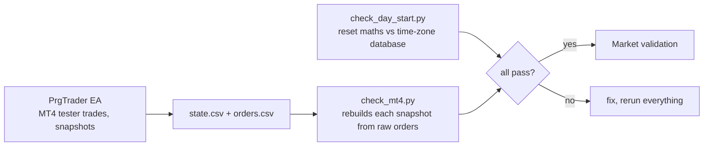

**3. Market validation.** Both Market builds passed the MQL5 Market's automated product validation before publication (the Market's
own check, not part of this repository).

**What the tests do not cover.** The engine tests ran on the **MT4 edition** (the MT5 engine is the same calculation using the MT5
deal list instead of orders; it was not run through the same tester harness for this repository). The panel text and the alert
delivery are not compared. The Strategy Tester has no real server clock, so *Auto* clock detection is only exercised live.

## Architecture

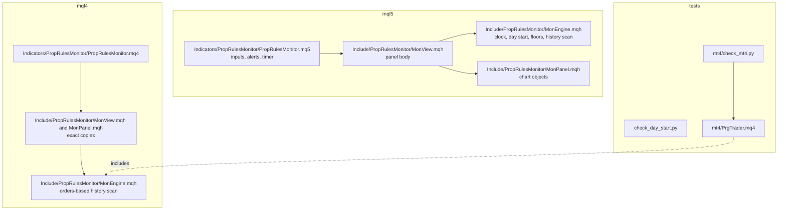

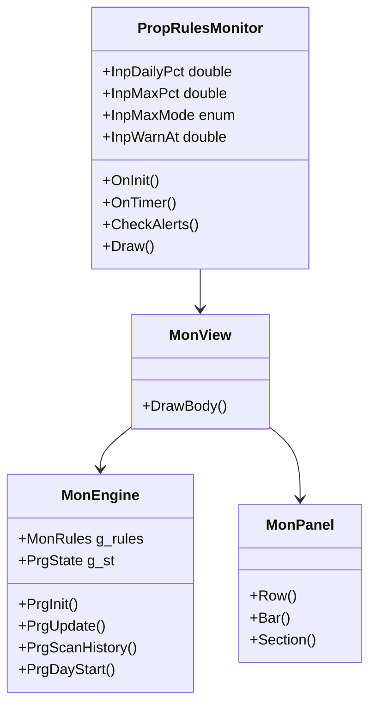

The indicator has no buffers and no `iCustom` interface: it is a panel.

## Inputs, alerts, install and compile

| Input | Default | Meaning |
|---|---|---|
| Daily loss limit, % | 5 (0 = off) | Of the account size or of the day start |
| Limit is / Measured from | % of the initial balance / balance at the reset | Daily rule |
| Day resets in time zone / at hour | Central Europe / 0 | Reset rule |
| Max loss, % of account size | 10 (0 = off) | Overall limit |
| Max loss type | Static | Static, trailing from equity, closed balance or end-of-day balance, or two-stage |
| Trailing floor stops at the account size | false | Trailing types only |
| Two-stage: after a closed gain of % / max loss becomes % | 5 / 5 | Two-stage only |
| Account size | 0 (first deposit) | |
| Profit target, % / Minimum trading days | 10 / 4 | Shown on the panel |
| Warn at % of a limit used | 80 | |
| Pop-up alert / Push notification | true / false | Push needs your MetaQuotes ID |
| Panel position, margins, font size, light colours | left, 10, 26, 9, false | Display |
| Broker server clock / offset from UTC | Auto / 0 | Auto, New York close, EET or fixed |

**Install from source.** MT5: copy `mql5/Indicators/PropRulesMonitor/` into `<terminal data folder>/MQL5/Indicators/` and
`mql5/Include/PropRulesMonitor/` into `<data folder>/MQL5/Include/`. MT4: the same with `mql4/`. Open `PropRulesMonitor.mq5` or
`.mq4` in MetaEditor and press Compile (F7). Both compile with 0 errors and 0 warnings (checked with the MetaEditor of a MetaTrader 5
and a MetaTrader 4 build on a Windows machine; the compiled files are not in the repository). The indicator keeps the day start and
the peaks in terminal global variables named `PRG.<login>.MON.<field>`.

## Run the tests

```bash
python3 tests/check_day_start.py          # reset maths vs the time-zone database (Python 3.9+, standard library only)
```

For the MT4 engine test: compile `tests/mt4/PrgTrader.mq4` (it includes `<PropRulesMonitor\MonEngine.mqh>`, so install
`mql4/Include/PropRulesMonitor/` first), run it in the MetaTrader 4 Strategy Tester (open prices) for each symbol with the inputs in
`tests/mt4/configs.tsv`, collect the `*_state.csv` and `*_orders.csv` files it writes, and run
`python3 tests/mt4/check_mt4.py <folder with the files>`.

## Honest limits

- **You type the rules.** The Monitor knows no firm's rules; firms change them. Read your firm's own pages, and compare the day start
  and floors on the panel with the firm's dashboard.
- **It cannot know a missed reset exactly.** If it was not running at the reset, the day-start equity is rebuilt from the balance and
  the panel says "rebuilt".
- **One copy per account.** Copies share the stored day start and peaks (`PRG.<login>.MON.*`), so two copies with different reset
  rules would mix them. (A test found this: the test EA and the indicator, run together with different resets, disagreed on the
  peak end-of-day balance.)
- **A watcher, not a guard.** It never closes anything. In a fast market, a gap or a closed market equity can pass a floor before you
  react.
- **Tests.** The engine was compared in the MT4 tester and the zone maths against a time-zone database; the MT5 engine and the panel
  text were not run through the same harness (see above). No profit or pass claim is made.
- Locking, news handling, firm presets and the rest of the enforcement exist in a separate paid product (see below).

## Free vs Pro

| | Free: Prop Rules Monitor | Paid: Prop Rules Guard |
|---|---|---|
| Platforms | MT5 [201817](https://www.mql5.com/en/market/product/201817), MT4 [202433](https://www.mql5.com/en/market/product/202433) | MT5 [201823](https://www.mql5.com/en/market/product/201823), MT4 [202436](https://www.mql5.com/en/market/product/202436) |
| Price | free | paid (see the Market page) |
| What you get | Live daily loss and max loss on a panel, warnings and breach alerts, source here | An Expert Advisor that enforces the limits, as described on its Market listing |
| Source | this repository | not published |

No need to buy the paid product to use the free one: the free indicator is complete on its own.
Website: [allanninal.dev/mql5](https://www.allanninal.dev/mql5/#utilities) ([MT4](https://www.allanninal.dev/mql5/#mt4)).

## Licence

Everything is © 2026 Allan Niñal under the
[PolyForm Noncommercial License 1.0.0](LICENSES/PolyForm-Noncommercial-1.0.0.md): source-available, free for personal and other
noncommercial use, not for commercial use. Each source file has an `SPDX-License-Identifier` line; the text is in
[`LICENSE`](LICENSE). The licence applies to this source, not to anything you build or trade with the indicator. Trading involves
risk; the software is provided as is.

---

**Website:** [allanninal.dev/mql5](https://www.allanninal.dev/mql5/#utilities) · [MT4](https://www.allanninal.dev/mql5/#mt4) · [allanninal.dev](https://www.allanninal.dev)
· Questions: message me on [LinkedIn](https://www.linkedin.com/in/allanninal/).
